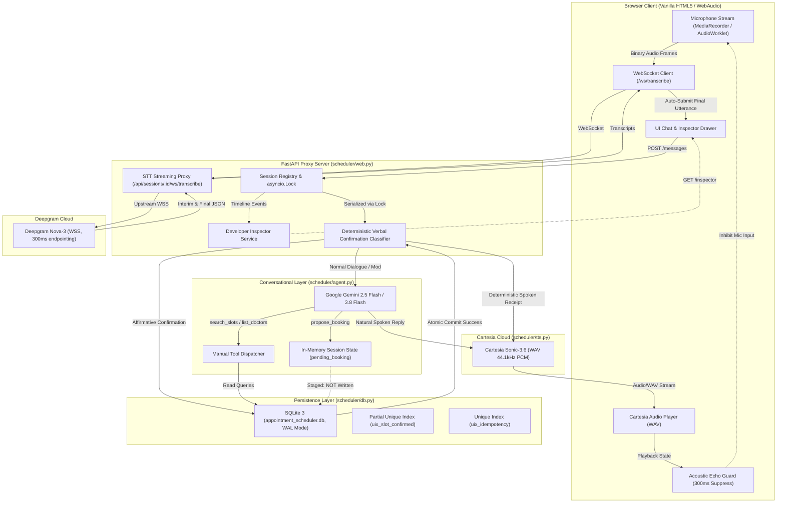

# Appointment Scheduler — System Architecture & Component Design

This document details the end-to-end technical architecture of **Appointment Scheduler**, a high-reliability clinical voice receptionist and appointment scheduling system. It covers data flow, networking boundaries, synchronization mechanics, database design, and key architectural trade-offs.

---

## 1. High-Level Architecture Diagram

### ASCII Component Architecture

```
+---------------------------------------------------------------------------------------------------------+
|                                              BROWSER CLIENT                                             |
|                                                                                                         |
|   +--------------------------+    Binary Audio (WSS)     +--------------------------+                   |
|   |   WebAudio Microphone    | ------------------------> |   WebSocket Audio Client |                   |
|   |  (16kHz / 44.1kHz PCM)   |                           | (Auto-endpointing & VAD) |                   |
|   +--------------------------+                           +--------------------------+                   |
|                 ^                                                     |                                 |
|                 | Audio Suppress / Echo Guard                         | JSON Utterance                  |
|                 v                                                     v                                 |
|   +--------------------------+                           +--------------------------+                   |
|   |   Cartesia Audio Player  | <------------------------ |   UI / Chat / Inspector  |                   |
|   |  (WAV Chunk Playback)    |       Audio Response      |      Timeline Stream     |                   |
|   +--------------------------+                           +--------------------------+                   |
+-----------------------------------------------------------------------|---------------------------------+
                                                                        |
                                         HTTPS / WSS (Localhost:8000)   |
                                                                        v
+---------------------------------------------------------------------------------------------------------+
|                                         FASTAPI BACKEND PROXY                                           |
|                                                                                                         |
|   +------------------------------------+         +--------------------------------------------------+   |
|   | Streaming STT Proxy (/ws/transcribe)         | Session State Registry                           |   |
|   | - Session Validation               |         | - Dedicated Agent Instance                       |   |
|   | - Deepgram Key Protection          |         | - In-Memory `asyncio.Lock` per Session           |   |
|   | - Binary / JSON Passthrough        |         | - Event Inspector Timeline Logging               |   |
|   +------------------------------------+         +--------------------------------------------------+   |
|                      |                                                    |                             |
|       WSS Stream     |                                                    | Synchronized                |
|                      v                                                    v Turn Dispatch               |
|   +------------------------------------+         +--------------------------------------------------+   |
|   | External STT: Deepgram Nova-3      |         | Verbal Confirmation State Machine                |   |
|   | - Realtime Speech-to-Text          |         | - `is_verbal_confirmation()` (Affirmative)       |   |
|   | - 300ms Endpointing / 1000ms End   |         | - `is_verbal_cancellation()` (Cancellation)      |   |
|   +------------------------------------+         | - `is_verbal_modification()` (Change Preference) |   |
|                                                  | - `is_verbal_ambiguity()` (Clarification Guard)  |   |
|                                                  +--------------------------------------------------+   |
|                                                                   /                  \                  |
|                                        Affirmative Interception /                      \ Normal Turns / |
|                                              (Bypasses LLM)   /                          \ Modification |
|                                                              v                            v             |
|                  +----------------------------------------------+        +--------------------------+   |
|                  | Deterministic Booking Controller             |        | Gemini 2.5/3.8 Flash     |   |
|                  | - `Agent.confirm_booking()`                  |        | Conversational Engine    |   |
|                  | - Stable Idempotency Key Validation          |        | - System Instruction     |   |
|                  | - Formats Spoken Receipt Deterministically   |        | - Read-only Slot Search  |   |
|                  +----------------------------------------------+        | - `propose_booking()`    |   |
|                                     |                                    +--------------------------+   |
|                                     | Atomic ACID                                     |                 |
|                                     | Transaction                                     | Staging Only    |
|                                     v                                                 v                 |
|                  +----------------------------------------------+        +--------------------------+   |
|                  | SQLite WAL Database (appointment_scheduler.db)         |        | Session In-Memory State  |   |
|                  | - `BEGIN IMMEDIATE` Serialization            | <..... | `pending_booking`:       |   |
|                  | - Partial Index `uix_slot_confirmed`         | (Read) | - slot_id, doctor, time  |   |
|                  | - Idempotency Index `uix_idempotency`        |        | - status: awaiting_conf  |   |
|                  +----------------------------------------------+        +--------------------------+   |
|                                     |                                                 |                 |
|                                     +-----------------------+-------------------------+                 |
|                                                             |                                           |
|                                                             v                                           |
|                                          +-------------------------------------+                        |
|                                          | Cartesia TTS Client (`sonic-3.6`)   |                        |
|                                          | - Spoken Text Normalization         |                        |
|                                          | - PCM 16-bit 44.1kHz WAV Generation |                        |
|                                          +-------------------------------------+                        |
|                                                             |                                           |
+-------------------------------------------------------------|-------------------------------------------+
                                                              |
                                                              v Upstream API
                                           +-------------------------------------+
                                           | Cartesia Cloud API                  |
                                           | - Ultra-low latency voice synthesis |
                                           +-------------------------------------+
```

---

## 2. Mermaid Architecture Diagram

The system architecture diagram is also rendered as a Mermaid flowchart below:



---

## 3. Core Component Breakdown

### 3.1 Browser UI & Audio Pipeline (`scheduler/static/index.html`)
- **WebAudio Ingestion**:
  - Captures microphone input at 16 kHz or 44.1 kHz via `navigator.mediaDevices.getUserMedia`.
  - Streams binary PCM chunks over a dedicated WebSocket to the backend.
- **Audio Output & Echo Suppression**:
  - Uses the HTML5 `AudioContext` / `<audio>` element to play incoming 44.1 kHz 16-bit PCM WAV streams generated by Cartesia.
  - Implements an **echo suppression state machine**: incoming audio input from the microphone is muted or ignored while assistant audio is actively playing, plus an additional **300ms post-playback guard window** to eliminate room reverberation.
- **Utterance Finalization**:
  - Listens for Deepgram's `speech_final: true` and `UtteranceEnd` signals (300ms endpointing, 1000ms silence timeout).
  - Protected by a client-side mutex (`hasSubmittedCurrentUtterance`) to guarantee that an utterance is never submitted twice across overlapping endpointing events.

---

### 3.2 FastAPI Backend Proxy (`scheduler/web.py`)
- **Session Registry**:
  - Maps unique UUID-based `session_id` strings to dedicated `SessionState` instances in memory.
  - Holds an isolated `Agent` instance, an active Cartesia voice profile, and an `asyncio.Lock` per user.
- **Asynchronous Serialization**:
  - All operations on a session's agent history and staging state are wrapped in `async with session.lock:`.
  - Long-running CPU or blocking I/O calls (Gemini API, SQLite disk I/O) are offloaded to Python's background worker pool using Starlette's `run_in_threadpool`.
- **WebSocket STT Proxy (`/api/sessions/{session_id}/ws/transcribe`)**:
  - Bridges the browser client to Deepgram's upstream WebSocket server (`wss://api.deepgram.com/v1/listen`).
  - Shields the browser from seeing API keys and handles session validation.

---

### 3.3 Speech-to-Text: Deepgram Nova-3 (`scheduler/speech.py`)
- **Model**: Deepgram `nova-3` with `smart_format=true`.
- **Latency Optimizations**:
  - Streaming WebSocket interface delivers interim hypotheses with ~150–250ms latency.
  - Dynamic endpointing set to `300ms` for natural, snappy turn handoffs.
  - REST fallback endpoint (`transcribe_audio`) handles monolithic audio uploads (`audio/wav`, `audio/webm`, `audio/ogg`, `audio/mp4`).

---

### 3.4 Conversational Agent: Google Gemini 2.5 / 3.8 Flash (`scheduler/agent.py`)
- **Model Configuration**:
  - Uses Google's native `google-genai` SDK (`gemini-2.5-flash` or `gemini-3.8-flash`).
  - System prompt enforces concise conversational turns (strictly 15–30 words), at most two options presented at once, and strictly forbids reciting raw slot IDs or markdown.
- **Manual Function Calling**:
  - Tools exposed: `list_doctors()`, `search_slots(doctor_id, local_date)`, and `propose_booking(slot_id)`.
  - Gemini **never** has direct write access to the database. It only stages proposals.

---

### 3.5 Database & Persistence: SQLite WAL Mode (`scheduler/db.py`)
- **Database Engine**: SQLite 3 with `PRAGMA journal_mode=WAL` (Write-Ahead Logging) and `PRAGMA foreign_keys=ON`.
- **Schema & Indexes**:
  - `doctors`: ID, name, specialty.
  - `slots`: ID, doctor_id, start_utc, end_utc. Unique index: `uix_doctor_start ON slots(doctor_id, start_utc)`.
  - `bookings`: ID, slot_id, patient_name, status, idempotency_key, created_utc.
  - **Partial Unique Index**:
    ```sql
    CREATE UNIQUE INDEX IF NOT EXISTS uix_slot_confirmed
    ON bookings (slot_id)
    WHERE status = 'confirmed';
    ```
  - **Idempotency Index**:
    ```sql
    CREATE UNIQUE INDEX IF NOT EXISTS uix_idempotency
    ON bookings (idempotency_key);
    ```
- **Transaction Isolation**:
  - All mutating operations execute under `BEGIN IMMEDIATE` to prevent SQLite `SQLITE_BUSY` deadlocks during lock escalation.

---

### 3.6 Text-to-Speech: Cartesia Sonic-3.6 (`scheduler/tts.py`)
- **Model**: Cartesia `sonic-3.6` generating 44.1 kHz 16-bit PCM WAV.
- **Spoken Text Formatting**:
  - `format_spoken_text()` strips markdown characters (`*`, `#`, `_`, `` ` ``), bullet points, and bracketed metadata before sending to TTS.
  - `format_spoken_receipt()` deterministically renders human-friendly confirmation receipts (e.g., converting UTC timestamps to `"Tuesday, November 17 at 9:00 AM PST"` and `"Booking #1"`).
- **Allowlisted Voices**:
  - Curated set of professional, soothing medical voices (Madame Forestier, Dr. Sarah Brooks, Dr. Marcus Vance, Nurse Clara).

---

## 4. Key Design Rationales

### Rationale 1: Why Streaming STT Proxy vs. Direct Browser Connection?
In production systems, clients often connect directly to third-party WebSockets (e.g. Deepgram) using ephemeral tokens. For Appointment Scheduler, we deliberately chose a **server-side proxy (`/ws/transcribe`)**:
1. **API Key Isolation**: `DEEPGRAM_API_KEY` never touches client memory, eliminating browser scraping vulnerabilities.
2. **Session Verification**: The backend verifies that the session exists before establishing an upstream connection (rejecting invalid sessions with close code `4404`).
3. **Auditability & Observability**: Every audio frame and transcription event passes through the backend, allowing latency instrumentation and security logging without trusting client metrics.
4. **Protocol Decoupling**: If the STT provider changes (e.g. migrating from Deepgram to Whisper or an on-premise Kaldi model), the browser client remains completely unchanged.

---

### Rationale 2: Why In-Memory Session Synchronization Lock (`asyncio.Lock`)?
In conversational voice applications, asynchronous network events can arrive out of order (e.g. a delayed interim transcript packet arriving after a final utterance, or rapid duplicate clicks on "Confirm"):
1. **State Corruption Prevention**: A single `Agent` instance maintains turn history, pending proposals, and tool call states. If two coroutines mutate `agent.history` simultaneously, turns become interleaved or corrupted.
2. **Race Condition Prevention on Staged Slots**: If a patient says *"Yes, book it"* while a background modification turn is still resolving, the per-session lock ensures the modification finishes or cancels before the confirmation evaluation runs.
3. **Threadpool Boundary**: Since the `google-genai` SDK and SQLite operations are synchronous and blocking, executing them within `run_in_threadpool` while holding `session.lock` serializes access while allowing other web sessions to progress concurrently.

---

### Rationale 3: Why Local-Only Developer Inspector?
The Developer Inspector provides full visibility into internal state, event durations, and SQL rows:
1. **Zero Production Attack Surface**: In healthcare applications, exposing internal SQL keys, tool parameters, and timing logs creates significant HIPAA and penetration vulnerabilities.
2. **Deterministic IP Filtering**: Guarded by `_is_local_request(request)`, which validates that the client IP is strictly `127.0.0.1`, `::1`, or `testclient`. External access attempts immediately return `HTTP 403 Forbidden`.
3. **Data Scrubbing**: Internal API keys, provider credentials, and raw audio buffers are never serialized into the inspector JSON payload.
