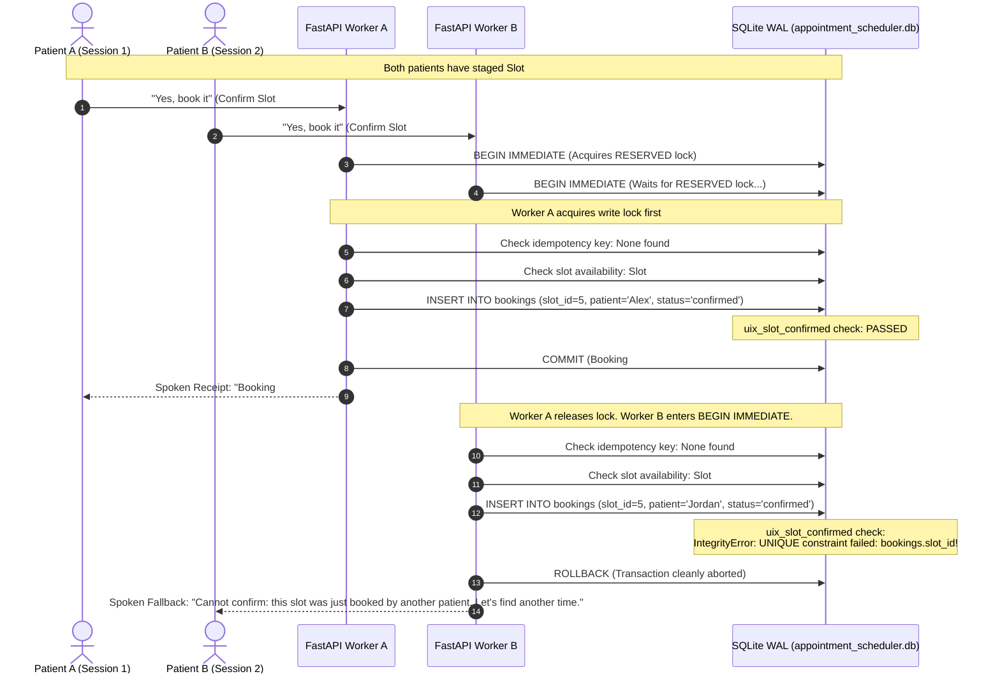

# Appointment Scheduler — Concurrency, Idempotency & Database Integrity

This document provides a comprehensive technical analysis of how **Appointment Scheduler** achieves high-throughput concurrent scheduling, guaranteed double-booking prevention, and idempotent retry safety using **SQLite Write-Ahead Logging (WAL)**, atomic transactions, and partial unique indexes.

---

## 1. Concurrency Model: SQLite in High-Concurrency Environments

A common misconception among software engineers is that SQLite cannot handle concurrent web applications. In Appointment Scheduler, SQLite is tuned to provide high-performance, crash-resilient concurrency:

### 1.1 Write-Ahead Logging (WAL) Mode
When a connection is established via `scheduler/db.py:_connect()`, the following PRAGMAs are executed:
```sql
PRAGMA journal_mode=WAL;
PRAGMA foreign_keys=ON;
```

#### Why WAL Mode Matters:
- **Reader-Writer Isolation**: In standard rollback journal mode, writing to the database locks the entire file, blocking all readers. In **WAL mode**, readers read from the main database file or the WAL index while a writer appends to the `-wal` file.
- **Concurrent Readers**: Unlimited concurrent threads or processes can query `list_available_slots()` without ever being blocked by an in-progress `book_slot()` transaction.
- **Fast Append Writes**: Writes are sequential appends to the WAL log rather than random file rewrites, resulting in sub-5ms commit latencies.

### 1.2 Write Serialization via `BEGIN IMMEDIATE`
SQLite supports three transaction modes:
1. `DEFERRED` (default): Locks are acquired only when a statement actually accesses the database. If two transactions begin as readers and later attempt to write, both attempt to upgrade to a reserved lock simultaneously, resulting in `SQLITE_BUSY` deadlock errors.
2. `EXCLUSIVE`: Prevents all reads and writes immediately.
3. **`IMMEDIATE` (Used by Appointment Scheduler)**:
   ```sql
   BEGIN IMMEDIATE;
   ```
   - Instantly acquires a **RESERVED lock** on the database file.
   - Guarantees that no other connection can begin a write transaction.
   - Readers continue reading without interruption.
   - Eliminates deadlock potential by serializing write access at the very start of `book_slot()` and `cancel_booking()`.

---

## 2. Double-Booking Prevention: The Partial Unique Index

### 2.1 The Problem with Simple Unique Constraints
In a clinical scheduling system, an appointment slot can be booked, then cancelled, and then re-booked by another patient:
- If we enforce `UNIQUE(slot_id)` across the entire `bookings` table, a patient can never re-book a slot that was previously cancelled.
- If we do not enforce uniqueness at the database level and rely on application-level checks (`if is_slot_available(): insert()`), two concurrent requests will suffer from a classic **Time-of-Check to Time-of-Use (TOCTOU)** race condition.

### 2.2 The Solution: Partial Unique Index
Appointment Scheduler implements a partial unique index in `scheduler/db.py`:
```sql
CREATE UNIQUE INDEX IF NOT EXISTS uix_slot_confirmed
ON bookings (slot_id)
WHERE status = 'confirmed';
```

#### Mathematical Proof of Correctness:
1. **Audit Trail Preservation**: A slot can have an arbitrary number of rows with `status = 'cancelled'`. Every cancellation is preserved for clinical and billing audits.
2. **Strict Invariant**: There can exist **at most one row** in `bookings` where `slot_id = S` and `status = 'confirmed'`.
3. **Hardware-Enforced Atomicity**: If two transactions attempt to insert a `'confirmed'` row for the same `slot_id`, the B-Tree engine of SQLite rejects the second insert with `sqlite3.IntegrityError: UNIQUE constraint failed: bookings.slot_id`.

---

## 3. Atomic Transaction Lifecycle in `book_slot()`

The execution of `scheduler/db.py:book_slot()` follows an exact 4-step atomic lifecycle:

```
[Start book_slot]
       |
       v
1. BEGIN IMMEDIATE -------------> Acquires RESERVED lock; serializes writers
       |
       v
2. Idempotency Key Check -------> SELECT * FROM bookings WHERE idempotency_key = ?
       |                          |-- Matches same payload: ROLLBACK & return existing Booking
       |                          \-- Reused with different payload: ROLLBACK & raise IDEMPOTENCY_CONFLICT
       v
3. Slot Validation -------------> SELECT id, start_utc FROM slots WHERE id = ?
       |                          |-- Slot does not exist: ROLLBACK & raise SLOT_NOT_FOUND
       |                          \-- Slot start <= UTC now: ROLLBACK & raise SLOT_IN_PAST
       v
4. Atomic Insert ---------------> INSERT INTO bookings (slot_id, patient, 'confirmed', key, now)
       |                          |-- Conflict on uix_slot_confirmed: ROLLBACK & raise SLOT_UNAVAILABLE
       |                          \-- Success: Retrieve last_insert_rowid()
       v
5. COMMIT ----------------------> Flushes WAL frame; releases RESERVED lock; returns Booking
```

### Rollback Guarantees
If any failure occurs—network timeout, foreign key violation, or slot conflict—`conn.rollback()` is immediately invoked in the `except` block. No partially written state or dirty reads can ever escape into the database.

---

## 4. Idempotency Mechanics: Network Retries Without Side Effects

In distributed voice and web systems, network packets drop frequently. A client might submit a confirmation, lose connection, and immediately retry.

### 4.1 Idempotency Key Structure
Every proposal staged by Appointment Scheduler generates a unique, deterministic idempotency key:
```python
idempotency_key = f"book-{slot_id}-{uuid.uuid4().hex[:12]}"
```
This key is stored in the agent's memory during `propose_booking()` and passed to `book_slot()`.

### 4.2 Handling Duplicate Invocations
When `book_slot()` receives an `idempotency_key`, it queries:
```sql
SELECT * FROM bookings WHERE idempotency_key = ?;
```
1. **Identical Replay (Safe Idempotence)**:
   - If a row exists with the same `slot_id` and `patient_name`, the function rolls back the write transaction and returns the previously created `Booking` object.
   - The caller receives a success response with the original `Booking ID`.
   - **Zero duplicate rows are created**.
2. **Payload Conflict Detection**:
   - If a row exists with the same `idempotency_key` but a *different* `slot_id` or `patient_name`, the transaction rolls back and raises:
     ```python
     raise BookingError("Idempotency key already used for a different request.", IDEMPOTENCY_CONFLICT)
     ```
   - This prevents replay attacks or client bugs where a stale key is accidentally attached to a new appointment request.

---

## 5. Race Condition Analysis: Two Patients Competing for the Same Slot

To demonstrate thread-safety and race condition immunity, consider two distinct patients (Patient A and Patient B) attempting to confirm the exact same slot at the exact same millisecond:



### Verification in Automated Test Suite
This exact concurrency scenario is validated by automated tests in `tests/test_web.py` and `tests/test_db.py`:
- `test_two_sessions_competing_for_same_slot`: Spawns two concurrent asynchronous HTTP requests against `/api/sessions/{id}/confirm` for the identical slot.
- **Result**: Exactly one request succeeds with `HTTP 200` and creates Booking `#1`. The competing request receives `SLOT_UNAVAILABLE` with a clean error message, and the SQLite database contains strictly one confirmed row.
