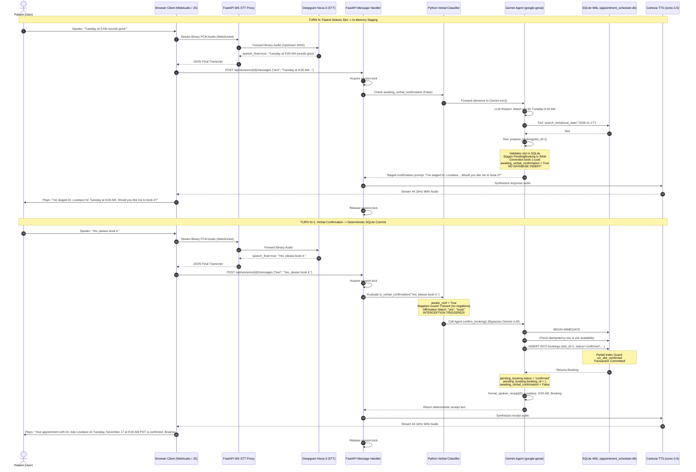

# Appointment Scheduler — Verbal Confirmation Sequence & Staging Flow

This document provides a deep architectural trace of the **verbal confirmation sequence** in Appointment Scheduler. It illustrates how patient speech transitions from raw audio into an uncommitted proposal, and how verbal affirmation is deterministically intercepted and committed to SQLite without delegating booking authority to the LLM.

---

## 1. Sequence Diagram: Turn-by-Turn Trace

The following Mermaid sequence diagram traces two critical conversational turns:
1. **Turn N (Staging)**: The patient selects a slot; Gemini invokes `propose_booking(slot_id)` to stage the appointment in memory.
2. **Turn N+1 (Confirmation)**: The patient affirms verbally (*"Yes, book it"*); Python intercepts the utterance, executes an atomic ACID transaction against SQLite, formats the receipt deterministically, and invokes Cartesia TTS.



---

## 2. Step-by-Step Architectural Walkthrough

### Phase 1: Ingestion & Transcription
1. **Audio Capture**: The patient speaks into their microphone. WebAudio captures 16-bit PCM frames.
2. **Streaming WebSocket**: Audio is streamed over `/api/sessions/{id}/ws/transcribe` to the FastAPI backend, which proxies frames to Deepgram Nova-3.
3. **Endpointing**: Deepgram's Voice Activity Detection (VAD) detects a 300ms pause and marks `speech_final=true`.
4. **Utterance Dispatch**: The browser receives the JSON transcript and immediately dispatches a `POST` request to `/api/sessions/{id}/messages`.

---

### Phase 2: In-Memory Staging (`propose_booking`)
1. **Session Serialization**: FastAPI acquires `session.lock` to serialize turn execution.
2. **Gemini Tool Invocation**: Gemini parses the user's intent (*"Tuesday morning at 9:00 AM"*), queries slot availability via `search_slots()`, and decides to call `propose_booking(slot_id=1)`.
3. **The Staging Invariant**:
   - `propose_booking()` checks that the slot exists and is unbooked.
   - It instantiates a `PendingBooking` object in the agent's memory:
     ```python
     PendingBooking(
         slot_id=1,
         doctor_name="Dr. Ada Lovelace",
         specialty="Cardiology",
         local_time_str="Tuesday, Nov 17, 2026 at 09:00 AM PST",
         patient_name="Alex Taylor",
         idempotency_key="book-1-e4f8b2a19c3d",
         status="awaiting_confirmation",
     )
     ```
   - It sets `agent.awaiting_verbal_confirmation = True`.
   - **Zero SQL Mutating Queries**: No `INSERT` or `UPDATE` statements are sent to SQLite. The database remains in its pristine initial state.
4. **Spoken Confirmation Read-Back**: Gemini generates a concise spoken prompt reading back the physician, day, date, and local time, ending with an explicit confirmation question:
   > *"I have staged Dr. Ada Lovelace for Tuesday, November 17th at 9:00 AM. Would you like me to go ahead and book this appointment for you?"*

---

### Phase 3: Verbal Confirmation Interception
1. **User Affirmation**: The patient responds naturally: *"Yes, please book it."*
2. **Deterministic Interception**: In `scheduler/agent.py:handle_turn()`, the code checks if `self.awaiting_verbal_confirmation` is `True`.
3. **Regex Classification Pipeline**:
   - **Modification Check (`is_verbal_modification`)**: Checks if the patient is changing their mind (e.g. *"Actually, what about 2 PM?"*). If true, discards the proposal and invokes Gemini.
   - **Cancellation Check (`is_verbal_cancellation`)**: Checks if the patient is canceling (e.g. *"No, don't book that"*). If true, calls `cancel_pending()` and returns immediately.
   - **Ambiguity Check (`is_verbal_ambiguity`)**: Checks if the user is hesitant (e.g. *"Wait, let me check"*). If true, repeats the confirmation prompt without mutating state.
   - **Affirmation Match (`is_verbal_confirmation`)**:
     - Validates that no negation words exist (`no`, `not`, `dont`, `never`, `cancel`, `stop`, `discard`).
     - Matches affirmative tokens (`yes`, `book`, `confirm`, `please`, `sounds good`, `proceed`).
4. **Total LLM Bypass**: Once affirmative confirmation is verified, **Gemini is not invoked**. The flow routes directly to Python's `agent.confirm_booking()`.

---

### Phase 4: Atomic Commit & Spoken Receipt
1. **ACID Transaction**:
   - `scheduler/db.py:book_slot()` opens a connection and executes `BEGIN IMMEDIATE`, instantly obtaining SQLite's reserved file lock.
   - Validates that the slot is still in the future and not booked.
   - Attempts insertion into the `bookings` table with status `'confirmed'` and the pre-generated `idempotency_key`.
   - SQLite enforces the partial unique index `uix_slot_confirmed`. If a race condition occurred and another session booked the slot, SQLite raises `sqlite3.IntegrityError`, which rolls back the transaction and raises `BookingError(SLOT_UNAVAILABLE)`.
2. **State Finalization**:
   - On commit, the row ID is retrieved (`last_insert_rowid()`).
   - `pending_booking.status` transitions from `'awaiting_confirmation'` to `'confirmed'`.
   - `pending_booking.booking_id` is populated with the generated ID (e.g. `#1`).
   - `awaiting_verbal_confirmation` resets to `False`.
3. **Spoken Receipt Generation**:
   - `format_spoken_receipt()` deterministically constructs the audio transcript:
     > *"Your appointment with Dr. Ada Lovelace on Tuesday, November 17 at 9:00 AM PST is confirmed. Your confirmation number is Booking #1. We look forward to seeing you."*
   - Cartesia synthesizes the audio in ~300ms, and the browser plays the confirmation receipt.

---

## 3. Architectural Contrast: LLM Staging vs. Deterministic Backend Commit

The table below contrasts the technical characteristics of LLM staging against the deterministic backend commit:

| Feature / Attribute | LLM Staging (`propose_booking`) | Deterministic Commit (`confirm_booking`) |
|---|---|---|
| **Execution Authority** | LLM (Google Gemini Flash via tool calling) | Python Backend (`scheduler/db.py`) |
| **Storage Medium** | Ephemeral Session Memory (`Agent.pending_booking`) | Disk-backed SQLite Database (WAL Mode) |
| **Persistence Across Reboots** | Lost on server crash or restart | Fully ACID persistent on disk (`appointment_scheduler.db`) |
| **Concurrency Guarantees** | None (advisory proposal only) | Strict mutual exclusion via `BEGIN IMMEDIATE` |
| **Double-Booking Defense** | None (cannot prevent concurrent claims) | Absolute mathematical guard via `uix_slot_confirmed` |
| **Hallucination Risk** | High if allowed to book; Zero because write is prohibited | **Zero**: Deterministic regex + hardcoded SQL query |
| **Failure Semantics** | Fails closed: invalidates proposal | Full transaction rollback (`ROLLBACK` on exception) |
| **Idempotency** | Stable key generated (`book-{slot_id}-{uuid}`) | Key enforced by `uix_idempotency` index |
| **Turn Latency** | ~1200ms – 2500ms (LLM inference + tool round) | **3.2ms** (Direct SQL insert; skips LLM entirely) |
| **Spoken Output** | Conversational prompt shaped by system instructions | Deterministic receipt via `format_spoken_receipt()` |

---

## 4. Failure Mode Matrix & State Invariants

| Failure Scenario | Where Detected | System Behavior | Resulting State |
|---|---|---|---|
| **Patient says "Actually, cancel that"** | `is_verbal_cancellation` in Python | `cancel_pending()` called; DB untouched | Pending proposal discarded; `idle` |
| **Patient says "Can I do 2 PM instead?"** | `is_verbal_modification` in Python | Pending Slot #1 discarded; forwarded to Gemini | Gemini stages Slot #2 in memory |
| **Patient says "Wait a second"** | `is_verbal_ambiguity` in Python | Proposal preserved; agent prompts for clarification | Pending proposal retained; awaits clarification |
| **Patient drops call / disconnects** | Browser / WebSocket disconnect | In-memory session discarded on timeout or restart | Zero orphaned bookings in database |
| **Concurrent session claims slot first** | SQLite `book_slot()` insert | Catches `IntegrityError: bookings.slot_id` | Transaction rolled back; patient notified |
| **Patient repeats "Yes, book it" twice** | SQLite `book_slot()` idempotency check | Identifies reused `idempotency_key` | Returns existing booking without duplicate row |
